# edge-containers

<p align="center">
  
  
  
  
</p>

<p align="center">
  <b>Production container images for NVIDIA Jetson edge GPUs</b> — a full streaming
  voice stack (speech recognition + synthesis) and a spec-driven benchmark harness.
  One fat image per package serves <b>both boards</b> (native cubins for sm_87 +
  sm_110a plus forward-compat PTX), built on CUDA 13.2 SBSA / JetPack 7.2.1
  userspace with the GPU driver injected from the host.
</p>

> Status: **local only** — nothing is on Docker Hub or GitHub yet. The publish
> workflow activates when this repo is pushed and tagged.

<p align="center">
  <a href="#engine-families">Families</a> •
  <a href="#-benchmarks">Benchmarks</a> •
  <a href="#projects">Projects</a> •
  <a href="#quick-start">Quick start</a> •
  <a href="#benchmarking">Benchmarking</a> •
  <a href="#ci">CI</a>
</p>


## Engine families

> Measured on **jetson-agx-thor-128gb** (default power) — every number below comes from
the committed raw artifacts; full tables and charts in [Benchmarks](#-benchmarks).


<table width="100%">
  <tr>
    <td width="50%" valign="top" align="center">
      <br>
      <h3>🦜&nbsp;parakeet.cpp</h3>
      <p>one parakeet.cpp runtime, several q8_0 GGUF models</p>
      <p>nemotron-labs-unified-asr-0.6b-q8_0<br>phonon-2.5-english-q8_0<br>redux-q8_0<br>parakeet-redux packed (redux-packed.gguf)<br></p>
      <p><em>true buffered streaming (0.16–2.08 s chunks)</em></p>
      <br>
    </td>
    <td width="50%" valign="top" align="center">
      <br>
      <h3>⚡&nbsp;faster-whisper</h3>
      <p>faster-whisper 1.2.1 on our CTranslate2 4.8.4 build</p>
      <p>faster-whisper-tiny-int8<br></p>
      <p><em>Wyoming streaming</em></p>
      <br>
    </td>
  </tr>
</table>


<table width="100%">
  <tr>
    <td width="25%" valign="top" align="center">
      <br>
      <h3>🗣️&nbsp;kokoro</h3>
      <p>Kokoro-82M v1.0, int8 ONNX on onnxruntime-gpu</p>
      <p>Kokoro-82M v1.0 int8 (model_uint8.onnx)<br></p>
      <p><em>create_stream()</em></p>
      <br>
    </td>
    <td width="25%" valign="top" align="center">
      <br>
      <h3>✨&nbsp;paradee</h3>
      <p>Paradee-8M v1.0 int8 ONNX — a Kokoro distillation</p>
      <p>Paradee-8M-v1.0 int8 (baked)<br>Paradee-8M-v1.0 int8 (baked)<br></p>
      <p><em>sentence-chunked</em></p>
      <br>
    </td>
    <td width="25%" valign="top" align="center">
      <br>
      <h3>🎺&nbsp;piper1-tts</h3>
      <p>piper-tts 1.8.0 on our onnxruntime-gpu build</p>
      <p>en_US-libritts_r-medium<br></p>
      <p><em>Wyoming streaming</em></p>
      <br>
    </td>
    <td width="25%" valign="top" align="center">
      <br>
      <h3>🌊&nbsp;phonon-31m</h3>
      <p>gradium/phonon-31m-en via the ptts runtime — CPU-only by design</p>
      <p>phonon-31m-en<br></p>
      <p><em>true streaming on CPU (307 MB)</em></p>
      <br>
    </td>
  </tr>
</table>


## 📊 Benchmarks

> Rendered from the raw benchmark artifacts (`benchmarks/raw/`, `benchmarks/history.jsonl`)
by `bench plot --readme` — regenerate with `make bench-plot`. 
> Cohort: **jetson-agx-thor-128gb · default power · commit 4dd4272 · 2026-10-31**.


### Speech recognition — LibriSpeech test-clean

| engine | model | backend | WER | CER | SER | halluc. | RTF p50 | RTF p90 | lat p50 (s) | lat p90 (s) | mem MiB | GPU W |
|---|--:|--:|--:|--:|--:|--:|--:|--:|--:|--:|--:|--:|
| 🥇 nemotron-unified-asr | nemotron-labs-unified-asr-0.6b-q8_0 | cuda | $\color{#3fb950}{\text{0.0177}}$ | $\color{#3fb950}{\text{0.0047}}$ | $\color{#3fb950}{\text{0.2240}}$ | $\color{#3fb950}{\text{0.0000}}$ | $\color{#f85149}{\text{0.1113}}$ | $\color{#f85149}{\text{0.2486}}$ | $\color{#f85149}{\text{0.6912}}$ | 0.8496 | 2,119 | 11 |
| 🥈 phonon2-stt | phonon-2.5-english-q8_0 | cuda | 0.0199 | 0.0061 | 0.2620 | $\color{#3fb950}{\text{0.0000}}$ | 0.0900 | 0.2010 | 0.5754 | 0.6871 | 2,070 | 8 |
| 🥉 parakeet-redux-stt | redux-q8_0 | cuda | 0.0249 | 0.0083 | 0.3200 | $\color{#3fb950}{\text{0.0000}}$ | 0.0984 | 0.2206 | 0.5806 | 0.7790 | 2,102 | 18 |
| parakeet-redux-stt | parakeet-redux packed (redux-packed.gguf) | cpu | 0.0252 | 0.0083 | 0.3200 | $\color{#3fb950}{\text{0.0000}}$ | 0.0707 | 0.1041 | 0.4580 | $\color{#f85149}{\text{0.9607}}$ | 1,006 | — (CPU) |
| wyoming-faster-whisper | faster-whisper-tiny-int8 | cuda | $\color{#f85149}{\text{0.0722}}$ | $\color{#f85149}{\text{0.0280}}$ | $\color{#f85149}{\text{0.5940}}$ | $\color{#f85149}{\text{0.0020}}$ | $\color{#3fb950}{\text{0.0130}}$ | $\color{#3fb950}{\text{0.0185}}$ | $\color{#3fb950}{\text{0.0857}}$ | $\color{#3fb950}{\text{0.1507}}$ | 613 | 14 |

*500 utterances · 5 configurations · 🥇 **nemotron-unified 0.6B q8_0** at **1.77% WER**
(🥇🥈🥉 = composite top 3); fastest RTF p50
**0.013**. Green = best in column, red = worst. GPU W is the
tegrastats module draw over each engine's window; the packed-CPU engine has none
(hollow point, idle draw) in the power chart.*

<p align="center">
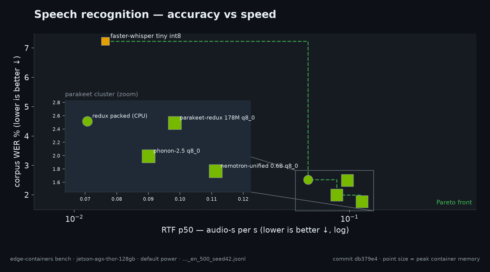
</p>

<details>
<summary><strong>More speech-recognition charts</strong> — distribution, power, memory, ranking, heatmap (★ = best on each chart)</summary>

<p align="center">
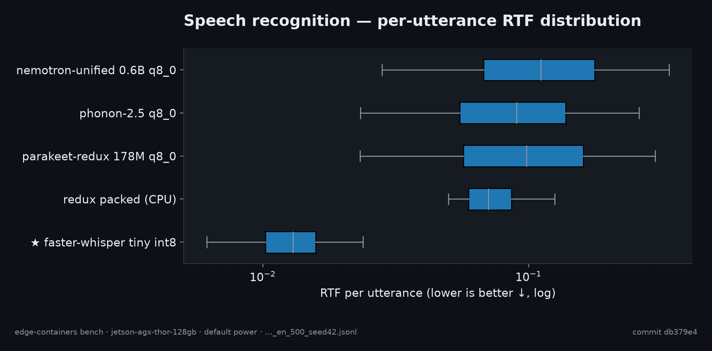
</p>

<p align="center">
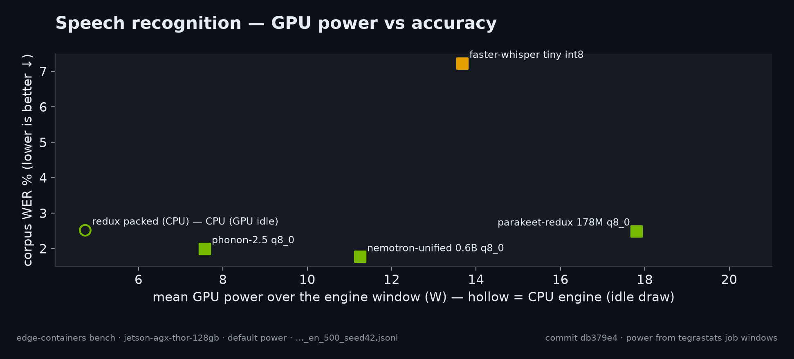
</p>

<p align="center">
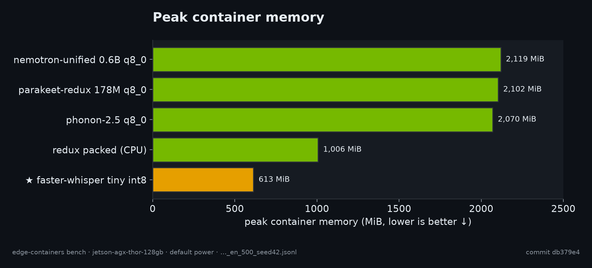
</p>

<p align="center">
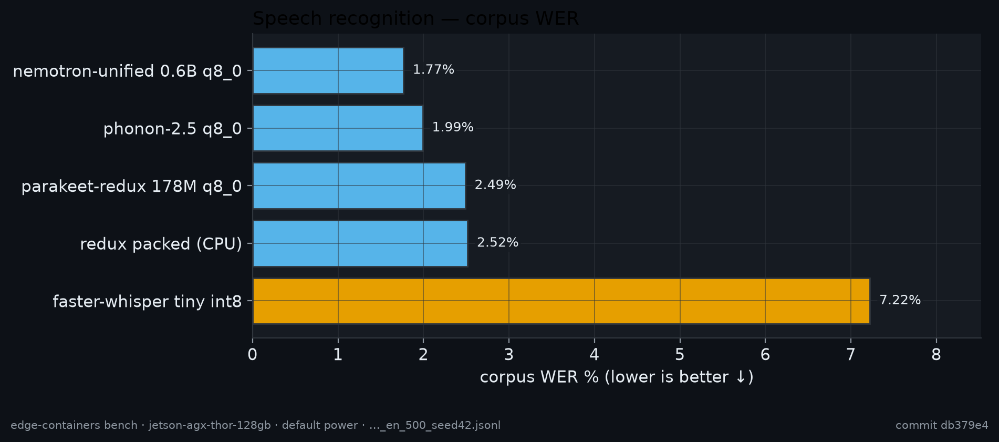
</p>

<p align="center">
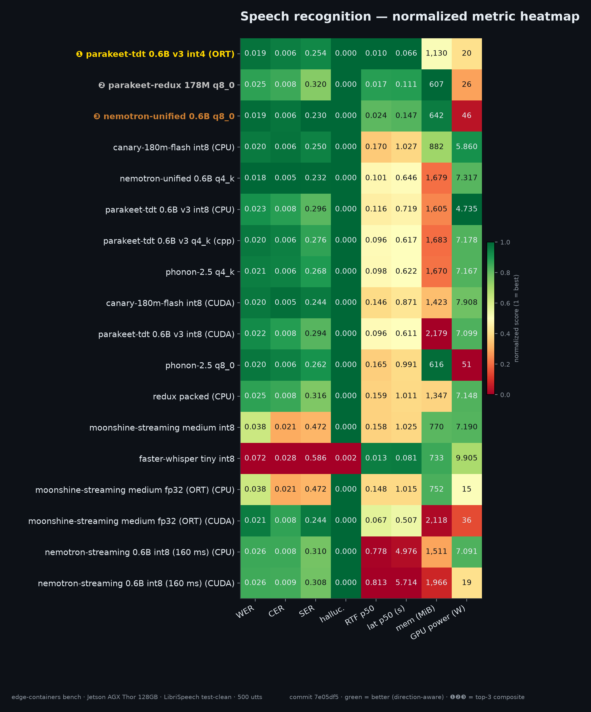
</p>
</details>


### Speech synthesis — 444 sentences (LibriSpeech text)

| engine | model | backend | RTF p50 | RTF p90 | synth p50 (s) | synth p90 (s) | TTFA p50 (s) | TTFA p90 (s) | mem MiB | GPU W |
|---|--:|--:|--:|--:|--:|--:|--:|--:|--:|--:|
| 🥇 kokoro-tts | Kokoro-82M v1.0 int8 (model_uint8.onnx) | cuda | 0.0850 | $\color{#f85149}{\text{0.1923}}$ | 0.5781 | 1.2016 | 0.5773 | 1.1899 | 1,526 | 34 |
| 🥈 paradee-tts | Paradee-8M-v1.0 int8 (baked) | cpu | $\color{#f85149}{\text{0.1503}}$ | 0.1522 | $\color{#f85149}{\text{1.1309}}$ | $\color{#f85149}{\text{3.2617}}$ | $\color{#f85149}{\text{1.1309}}$ | $\color{#f85149}{\text{3.2617}}$ | 604 | — (CPU) |
| 🥉 paradee-tts | Paradee-8M-v1.0 int8 (baked) | cuda | $\color{#3fb950}{\text{0.0188}}$ | $\color{#3fb950}{\text{0.0462}}$ | $\color{#3fb950}{\text{0.1414}}$ | 0.1912 | 0.1414 | 0.1912 | 1,508 | 16 |
| wyoming-piper1-tts | en_US-libritts_r-medium | cuda | 0.0334 | 0.0998 | 0.1587 | $\color{#3fb950}{\text{0.1738}}$ | 0.1587 | 0.1738 | 1,149 | 12 |
| phonon31m-tts | phonon-31m-en | cpu | 0.1237 | 0.1553 | 0.7679 | 2.3239 | $\color{#3fb950}{\text{0.0757}}$ | $\color{#3fb950}{\text{0.1124}}$ | 516 | — (CPU) |

*444 sentences · 5 configurations · 🥇🥈🥉 = composite top 3 · fastest RTF p50
**0.019**; best TTFA p50 **76 ms**
(300 ms gate). TTFA = time to first audio: streaming engines report the first
chunk; single-chunk engines (paradee, piper1-tts) deliver at synthesis completion, so
their TTFA equals the synth p50/p90.*

<p align="center">
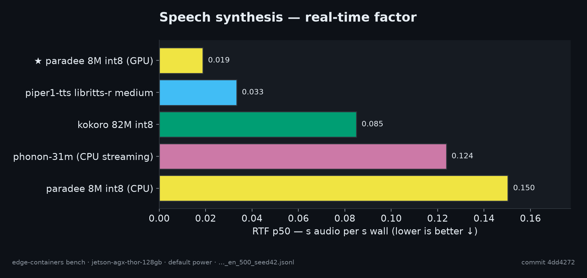
</p>

<p align="center">
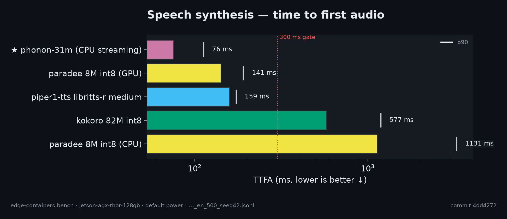
</p>

<details>
<summary><strong>More speech-synthesis charts</strong> — distributions, memory, heatmap (★ = best on each chart)</summary>

<p align="center">
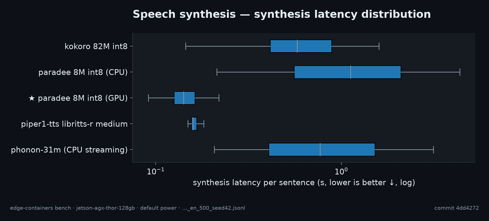
</p>

<p align="center">
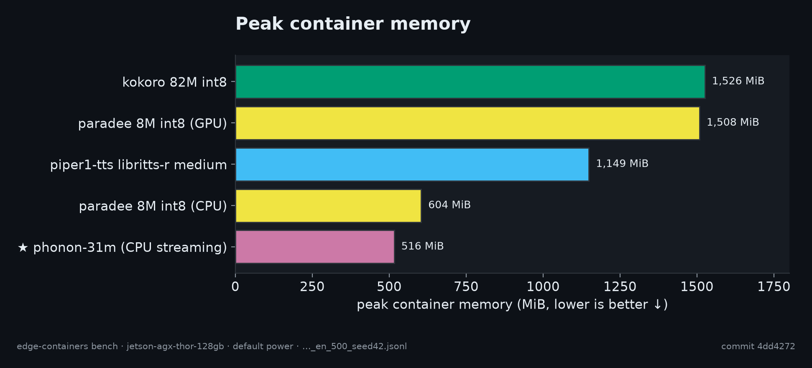
</p>

<p align="center">
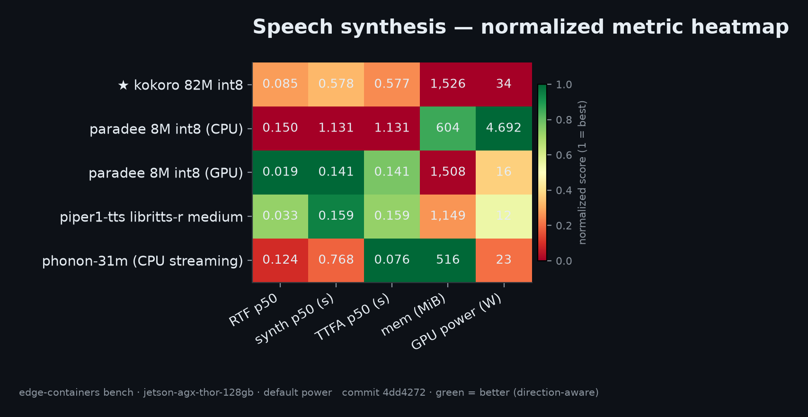
</p>
</details>


Full per-utterance data, probes and gate details: `reports/matrix/`, `docs/REPORT-benchmark.md`.


## Projects

### Speech recognition (`stt/`)

| Project | Image (`narandill/<name>`) | What it is | Streaming |
|---|---|---|---|
| `stt/wyoming-faster-whisper` | `wyoming-faster-whisper:0.1.0` | faster-whisper 1.2.1 on our CTranslate2 4.8.4 (sm_87+sm_110) | wyoming streaming |
| `stt/nemotron-unified-asr` | `nemotron-unified-asr:0.1.0` | nvidia/nemotron-labs-unified-asr-0.6b q8_0 GGUF on parakeet.cpp | **true buffered** (0.16–2.08 s) |
| `stt/parakeet-redux-stt` | `parakeet-redux-stt:0.1.0` | moondream/parakeet-redux (ternary 178M) q8_0 GPU + packed CPU | VAD-chunked (opt-in) |
| `stt/phonon2-stt` | `phonon2-stt:0.1.0` | Fermion Phonon-2.5-english q8_0 GPU + packed CPU | VAD-chunked (opt-in) |

### Speech synthesis (`tts/`)

| Project | Image (`narandill/<name>`) | What it is | Streaming |
|---|---|---|---|
| `tts/wyoming-piper1-tts` | `wyoming-piper1-tts:0.1.0` | piper-tts 1.8.0 on our onnxruntime-gpu 1.31.1 | wyoming streaming |
| `tts/kokoro-tts` | `kokoro-tts:0.1.0` | Kokoro-82M v1.0 int8 ONNX on onnxruntime-gpu (sm_87+sm_110a) | `create_stream()` |
| `tts/phonon31m-tts` | `phonon31m-tts:0.1.0` | gradium/phonon-31m-en via `ptts` — **CPU-only by design** (307 MB) | **true streaming** (TTFA ~76 ms p95) |
| `tts/paradee-tts` | `paradee-tts:0.1.0` | Paradee-8M-v1.0 int8 ONNX (Kokoro distillation) | sentence-chunked |

## Quick start

```bash
# 1) shared artifact builders (cached; seconds on replay)
make builders

# 2) build everything
make build-all          # or: cd tts/kokoro-tts && ./build.sh

# 3) verify cubins + smoke on the GPU (waits for free VRAM, never kills co-tenants)
make verify-all
make smoke-all

# 4) run something
docker run --runtime nvidia --rm -p 10300:10300 -v /data/wfw:/data narandill/wyoming-faster-whisper:0.1.0
docker run --runtime nvidia --rm --entrypoint stt-transcribe narandill/nemotron-unified-asr:0.1.0 /audio/x.wav
```

On pre-7.2.1 hosts add `-e NVIDIA_DISABLE_REQUIRE=1` to every `docker run` (driver
580.00 vs the baked 13.2 userspace — minor-version compatibility). After the host
upgrade, drop the flag.

## Layout

```
stt/                  speech-recognition images (wyoming-faster-whisper, nemotron-unified-asr, parakeet-redux-stt, phonon2-stt)
tts/                  speech-synthesis images (wyoming-piper1-tts, kokoro-tts, phonon31m-tts, paradee-tts)
llm/                  LLM runtime image (outside the voice stack)
builders/             shared artifact builders (wheels-cu132, parakeet-cpp) — not shipped
bench/                spec-driven benchmark harness (datasets, engines, probes, metrics)
benchmarks/           history.jsonl + raw run artifacts (committed) — feeds the charts
assets/benchmarks/    generated charts + manifest (committed)
reports/matrix/       generated matrix.csv/md + HTML per task
scripts/              sweep-build.sh / sweep-smoke.sh
docs/                 build & benchmark reports
```

Each project dir is standalone: `Dockerfile + build.sh + README +
test/{verify_arch,smoke_*}`.

**Decoupling contract:** an engine references shared artifacts only through a single
overridable ARG (`WHEELS_IMAGE`, `PARAKEET_DIST_IMAGE`) — see `ARCHITECTURE.md`.

## Benchmarking

```bash
make bench-prepare      # frozen manifests: 500 utterances + 444 sentences (LibriSpeech, seed 42)
make bench-selfcheck    # device, CUDA arch, probes, engines
bench/.venv/bin/python -m bench.cli run bench/configs/thor_stt_baseline.yaml
bench/.venv/bin/python -m bench.cli run bench/configs/thor_tts_baseline.yaml

# matrix + charts + README (reads benchmarks/history.jsonl — never re-runs inference)
make bench-plot
```

The runner **gates every GPU run on co-tenancy**: if other compute apps hold the GPU,
it waits for a clean window and defers rather than measure contaminated. Every run
appends to `benchmarks/history.jsonl`; baseline-class runs also publish their raw
artifacts to `benchmarks/raw/<run_id>/`.

## CI

| Workflow | Trigger | Runner | What it does |
|---|---|---|---|
| `lint.yml` | push/PR | `ubuntu-latest` | pre-commit (shellcheck, hadolint, ruff, yaml/json checks) |
| `build-smoke.yml` | `workflow_dispatch` | `[self-hosted, jetson]` | build matrix + arch verification (+ optional GPU smoke) |
| `publish.yml` | tag `v*` | `[self-hosted, jetson]` | build → arch gate → push all `narandill/*` tags (needs `DOCKERHUB_USER`/`DOCKERHUB_TOKEN` secrets) |

## Licenses

Build recipes are MIT. Each image carries its engine's license — check every project's
README (all engines here are permissive or OpenMDW; nothing NC).
