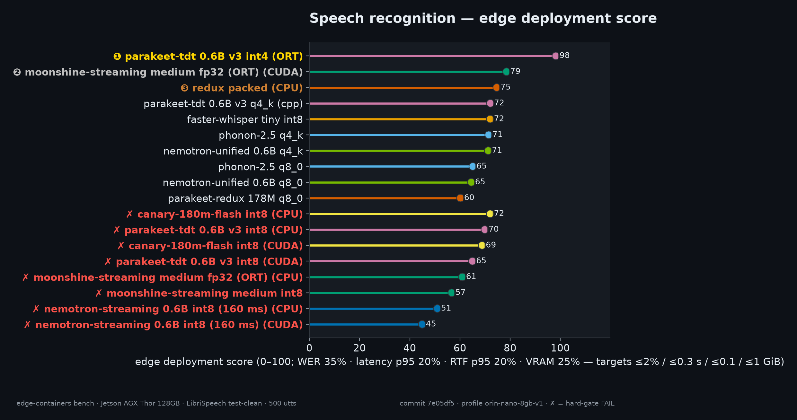
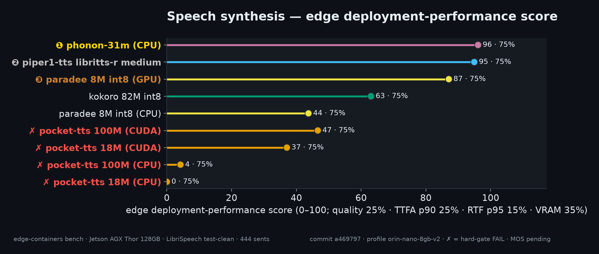

# edge-containers

<p align="center">
  
  
  
  
</p>

<p align="center">
  <b>Production container images for NVIDIA Jetson edge GPUs</b> — a full streaming
  voice stack (speech recognition + synthesis) and a spec-driven benchmark harness.
  One docker image per package serves <b>both boards</b> (native cubins for <code>sm_87</code> +
  <code>sm_110a</code> plus forward-compat PTX), built on CUDA 13.2 SBSA / JetPack 7.2.1
  userspace with the GPU driver injected from the host.
</p>

<p align="center">
  <a href="#packages">Packages</a> •
  <a href="#quick-start">Quick start</a> •
  <a href="#-benchmarks">Benchmarks</a> •
  <a href="#benchmarking">Benchmarking</a> •
  <a href="#ci">CI</a>
</p>

## Packages

### Speech recognition (`packages/stt/`)

| Package | Image (`narandill/<name>`) | Family | What it is | Streaming |
|---|---|---|---|---|
| [`canary-flash-stt`](packages/stt/canary-flash-stt/) | `canary-flash-stt:0.2.0` | 🐤 canary | NVIDIA Canary-180M-Flash int8 (en/de/es/fr + X↔EN) via sherpa-onnx | VAD-chunked (opt-in) |
| [`wyoming-faster-whisper`](packages/stt/wyoming-faster-whisper/) | `wyoming-faster-whisper:0.1.0` | ⚡ faster-whisper | faster-whisper 1.2.1 on our CTranslate2 4.8.4 (sm_87+sm_110) | wyoming streaming |
| [`moonshine-streaming-stt`](packages/stt/moonshine-streaming-stt/) | `moonshine-streaming-stt:0.2.0` | 🌙 moonshine | Moonshine Streaming Medium 245M via moonshine-voice (official ORT runtime) | **native incremental** (live partials) |
| [`nemotron-streaming-stt`](packages/stt/nemotron-streaming-stt/) | `nemotron-streaming-stt:0.2.0` | 🔊 nemotron-streaming | NVIDIA Nemotron Speech Streaming EN 0.6B int8 (160 ms lookahead) via sherpa-onnx | **true native** (cache-aware, graph-chunked) |
| [`parakeet-tdt-cpp-stt`](packages/stt/parakeet-tdt-cpp-stt/) | `parakeet-tdt-cpp-stt:0.1.0` | 🦜 parakeet-tdt | nvidia parakeet-tdt-0.6b-v3 q4_k GGUF (Orin budget) on parakeet.cpp | VAD-chunked (opt-in) |
| [`parakeet-tdt-ort-stt`](packages/stt/parakeet-tdt-ort-stt/) | `parakeet-tdt-ort-stt:0.1.0` | 🦜 parakeet-tdt | nvidia parakeet-tdt-0.6b-v3 int4 MatMulNBits (391 MB, featurizer incl.) on our onnxruntime-gpu | VAD-chunked (opt-in) |
| [`parakeet-tdt-stt`](packages/stt/parakeet-tdt-stt/) | `parakeet-tdt-stt:0.2.0` | 🦜 parakeet-tdt | NVIDIA Parakeet TDT 0.6B v3 int8 (25 languages) via sherpa-onnx | VAD-chunked (opt-in) |
| [`nemotron-unified-asr`](packages/stt/nemotron-unified-asr/) | `nemotron-unified-asr:0.2.0` | 🦜 parakeet.cpp | nvidia nemotron-unified-asr 0.6B (q8_0 GPU + q4_k Orin-budget) on parakeet.cpp | **true buffered** (0.16–2.08 s) |
| [`parakeet-redux-stt`](packages/stt/parakeet-redux-stt/) | `parakeet-redux-stt:0.1.0` | 🦜 parakeet.cpp | moondream parakeet-redux 178M (q8_0) GPU + packed CPU | VAD-chunked (opt-in) |
| [`phonon2-stt`](packages/stt/phonon2-stt/) | `phonon2-stt:0.2.0` | 🦜 parakeet.cpp | fermion phonon-2.5 (q8_0 GPU + q4_k Orin-budget + packed CPU) | VAD-chunked (opt-in) |

### Speech synthesis (`packages/tts/`)

| Package | Image (`narandill/<name>`) | Family | What it is | Streaming |
|---|---|---|---|---|
| [`kokoro-tts`](packages/tts/kokoro-tts/) | `kokoro-tts:0.1.0` | 🗣️ kokoro | Kokoro-82M v1.0 static-QLinear int8 ONNX on onnxruntime-gpu (sm_87+sm_110a) | `create_stream()` |
| [`paradee-tts`](packages/tts/paradee-tts/) | `paradee-tts:0.2.0` | ✨ paradee | Paradee-8M v1.2 int8 ONNX — a Kokoro distillation (4 voices) | sentence-chunked |
| [`phonon31m-tts`](packages/tts/phonon31m-tts/) | `phonon31m-tts:0.1.0` | 🌊 phonon-31m | gradium/phonon-31m-en via `ptts` — **CPU-only by design** (307 MB) | **true streaming** (TTFA ~76 ms p95) |
| [`wyoming-piper1-tts`](packages/tts/wyoming-piper1-tts/) | `wyoming-piper1-tts:0.1.0` | 🎺 piper1-tts | piper-tts 1.8.0 on our onnxruntime-gpu 1.31.1 | wyoming streaming |
| [`pocket-tts`](packages/tts/pocket-tts/) | `pocket-tts:0.3.0` | 🎒 pocket-tts | Kyutai Pocket TTS — 100M flagship + 18M Orin-budget (official pkg), streaming + voice cloning | **true streaming** (~200 ms TTFA) |

## Supported Hardware

One image per package serves **both boards** — native cubins for sm_87 and
sm_110a baked side by side, plus forward-compat PTX — so no per-board tags.

<table width="100%">
  <thead>
    <tr><th width="25%"></th><th align="center" width="37.5%"><strong>Jetson AGX Thor</strong></th><th align="center" width="37.5%"><strong>Jetson AGX Orin</strong></th></tr>
  </thead>
  <tbody>
    <tr><td align="center"><strong>status</strong></td><td align="center">✅ supported</td><td align="center">✅ supported</td></tr>
    <tr><td align="center"><strong>compute capability</strong></td><td align="center">sm_110a + sm_110 PTX</td><td align="center">sm_87 + sm_87 PTX</td></tr>
    <tr><td align="center"><strong>host software</strong></td><td align="center">JetPack 7.2.1+ (CUDA 13.2 SBSA userspace, driver injected from host)</td><td align="center">JetPack 7.2.1+ (CUDA 13.2 SBSA userspace, driver injected from host)</td></tr>
    <tr><td align="center"><strong>older hosts</strong></td><td align="center" colspan="2">driver 580.00 vs baked 13.2 userspace: add <code>-e NVIDIA_DISABLE_REQUIRE=1</code> (minor-version compatibility)</td></tr>
    <tr><td align="center"><strong>benchmarked</strong></td><td align="center">✅ measured — see <a href="#-benchmarks">Benchmarks</a></td><td align="center">— (same cubins, no numbers yet)</td></tr>
  </tbody>
</table>

## Quick start

```bash
# 1) shared artifact builders (cached; seconds on replay)
make builders

# 2) build everything
make build-all          # or: cd packages/tts/kokoro-tts && ./build.sh

# 3) verify cubins + smoke on the GPU (waits for free VRAM, never kills co-tenants)
make verify-all
make smoke-all

# 4) run something
docker run --runtime nvidia --rm -p 10300:10300 -v /data/wfw:/data narandill/wyoming-faster-whisper:0.1.0
docker run --runtime nvidia --rm --entrypoint stt-transcribe narandill/nemotron-unified-asr:0.1.0 /audio/x.wav
```

> On pre-7.2.1 hosts add `-e NVIDIA_DISABLE_REQUIRE=1` to every `docker run` (driver
580.00 vs the baked 13.2 userspace — minor-version compatibility). After the host
upgrade, drop the flag.


## 📊 Benchmarks

> Rendered from the raw benchmark artifacts (`benchmarks/raw/`, `benchmarks/history.jsonl`)
by `bench plot --readme` — regenerate with `make bench-plot`.
> Cohort: **jetson-agx-thor-128gb · default power · commit 3a7634f · 2026-11-03**.
Charts: ❶❷❸ mark the top-3 places (gold/silver/bronze) for that chart's ranking
metric; the scatter legends rank by composite score. Memory: **cgroup MiB**
counts the container's active file cache too (the model was just read from
disk); **anon MiB** is true process memory.


### Speech recognition — LibriSpeech test-clean

| engine | model | backend | WER | CER | SER | halluc. | RTF p50 | RTF p90 | lat p50 (s) | lat p90 (s) | cgroup MiB | anon MiB | GPU W |
|---|--:|--:|--:|--:|--:|--:|--:|--:|--:|--:|--:|--:|--:|
| 🥇 parakeet-tdt-ort-stt | parakeet-tdt 0.6B v3 int4 (ORT) | cuda | 0.0194 | 0.0061 | 0.2540 | $\color{#3fb950}{\text{0.0000}}$ | $\color{#3fb950}{\text{0.0103}}$ | 0.0194 | $\color{#3fb950}{\text{0.0661}}$ | $\color{#3fb950}{\text{0.0968}}$ | 1,130 | 1,076 | 20 |
| 🥈 canary-flash-stt | canary-180m-flash int8 | cpu | 0.0199 | 0.0055 | 0.2460 | $\color{#3fb950}{\text{0.0000}}$ | 0.1610 | 0.2283 | 0.9770 | 3.8869 | 777 | 766 | — (CPU) |
| 🥉 parakeet-redux-stt | redux packed (CPU) | cpu | 0.0252 | 0.0083 | 0.3200 | $\color{#3fb950}{\text{0.0000}}$ | 0.0743 | 0.1239 | 0.4879 | 0.9450 | 1,107 | 730 | — (CPU) |
| parakeet-tdt-stt | parakeet-tdt 0.6B v3 int8 | cpu | 0.0231 | 0.0079 | 0.3080 | $\color{#3fb950}{\text{0.0000}}$ | 0.1196 | 0.1298 | 0.7368 | 2.0574 | 1,313 | 1,300 | — (CPU) |
| nemotron-unified-asr | nemotron-unified 0.6B q4_k | cuda | 0.0181 | 0.0050 | 0.2320 | $\color{#3fb950}{\text{0.0000}}$ | 0.1013 | 0.2227 | 0.6458 | 0.7582 | 1,679 | 777 | 7 |
| parakeet-tdt-cpp-stt | parakeet-tdt 0.6B v3 q4_k (cpp) | cuda | 0.0202 | 0.0062 | 0.2760 | $\color{#3fb950}{\text{0.0000}}$ | 0.0963 | 0.2143 | 0.6170 | 0.7178 | 1,683 | 778 | 7 |
| phonon2-stt | phonon-2.5 q4_k | cuda | 0.0207 | 0.0062 | 0.2680 | $\color{#3fb950}{\text{0.0000}}$ | 0.0982 | 0.2136 | 0.6218 | 0.7318 | 1,670 | 778 | 7 |
| moonshine-streaming-stt | moonshine-streaming medium fp32 (ORT) | cpu | 0.0205 | 0.0080 | 0.2440 | $\color{#3fb950}{\text{0.0000}}$ | 0.1080 | 0.1335 | 0.6567 | 1.8402 | 2,358 | 2,334 | — (CPU) |
| moonshine-streaming-stt | moonshine-streaming medium fp32 (ORT) | cuda | 0.0205 | 0.0080 | 0.2440 | $\color{#3fb950}{\text{0.0000}}$ | 0.0376 | 0.0453 | 0.2381 | 0.6336 | 1,703 | 1,647 | 16 |
| canary-flash-stt | canary-180m-flash int8 | cuda | 0.0202 | 0.0054 | 0.2440 | $\color{#3fb950}{\text{0.0000}}$ | 0.1330 | 0.1842 | 0.8078 | 3.1153 | 1,347 | 1,101 | 8 |
| moonshine-streaming-stt | moonshine-streaming medium int8 | cpu | 0.0381 | 0.0210 | 0.4720 | $\color{#3fb950}{\text{0.0000}}$ | 0.1707 | 0.2672 | 1.1922 | 3.0605 | 657 | 643 | — (CPU) |
| nemotron-unified-asr | nemotron-unified 0.6B q8_0 | cuda | $\color{#3fb950}{\text{0.0177}}$ | $\color{#3fb950}{\text{0.0047}}$ | $\color{#3fb950}{\text{0.2240}}$ | $\color{#3fb950}{\text{0.0000}}$ | 0.1126 | 0.2469 | 0.7162 | 0.8270 | 2,179 | 1,030 | 7 |
| parakeet-tdt-stt | parakeet-tdt 0.6B v3 int8 | cuda | 0.0223 | 0.0076 | 0.2940 | $\color{#3fb950}{\text{0.0000}}$ | 0.0897 | 0.1049 | 0.5698 | 1.3966 | 1,983 | 1,735 | 7 |
| phonon2-stt | phonon-2.5 q8_0 | cuda | 0.0199 | 0.0061 | 0.2620 | $\color{#3fb950}{\text{0.0000}}$ | 0.1093 | 0.2421 | 0.6962 | 0.8076 | 2,188 | 1,031 | 7 |
| parakeet-redux-stt | parakeet-redux 178M q8_0 | cuda | 0.0249 | 0.0083 | 0.3200 | $\color{#3fb950}{\text{0.0000}}$ | 0.1108 | 0.2426 | 0.7019 | 0.8066 | 2,194 | 1,031 | 7 |
| wyoming-faster-whisper | faster-whisper tiny int8 | cuda | $\color{#f85149}{\text{0.0722}}$ | $\color{#f85149}{\text{0.0280}}$ | $\color{#f85149}{\text{0.5940}}$ | $\color{#f85149}{\text{0.0020}}$ | 0.0130 | $\color{#3fb950}{\text{0.0192}}$ | 0.0859 | 0.1511 | 616 | 562 | 13 |
| nemotron-streaming-stt | nemotron-streaming 0.6B int8 (160 ms) | cpu | 0.0261 | 0.0085 | 0.3120 | $\color{#3fb950}{\text{0.0000}}$ | 0.7844 | 0.7971 | 4.9934 | 13.5 | 1,364 | 1,344 | — (CPU) |
| nemotron-streaming-stt | nemotron-streaming 0.6B int8 (160 ms) | cuda | 0.0262 | 0.0085 | 0.3080 | $\color{#3fb950}{\text{0.0000}}$ | $\color{#f85149}{\text{0.8077}}$ | $\color{#f85149}{\text{0.8219}}$ | $\color{#f85149}{\text{5.1436}}$ | $\color{#f85149}{\text{13.9}}$ | 1,868 | 1,800 | 8 |

> *500 utterances · 18 configurations · 🥇 **parakeet-tdt 0.6B v3 int4 (ORT)** at **1.94% WER**
(🥇🥈🥉 = composite top 3); fastest RTF p50
**0.010**. Green = best in column, red = worst. GPU W is the
tegrastats module draw over each engine's window; the packed-CPU engine has none
(hollow point, idle draw) in the power chart.*

<p align="center">

</p>

<details>
<summary>How the edge deployment score is calculated (profile orin-nano-8gb-v2)</summary>

Each vector is scored against *absolute* anchors — never against the other engines — so
adding a config never rewrites a historical score. A vector scores 1.0 at/better than its
target, 0.0 at its worst-acceptable bound, log-linear in between (RTF, latency and memory
are heavy-tailed: the last halving counts as much as the first). The score is the
weighted mean ×100 of **WER** (target 2%, worst 10%, weight 0.30) · **latency p95**
(0.3 s, 1.5 s, 0.20) · **RTF p95** (0.1, 1.0, 0.15) · **VRAM, anon peak** (1 GiB,
3 GiB, 0.35).

</details>

$$
S_i=\text{clip}\left(\frac{\ln(W_i/x_i)}{\ln(W_i/T_i)}, 0, 1\right)
\qquad
\text{score}=100\cdot\frac{\sum_i w_i S_i}{\sum_i w_i}
$$

<details>
<summary>Why p95 & anon peak — and the hard gates</summary>

Latency and RTF bind the *tail* (p95 — averages hide the spikes that make an assistant
feel broken). Memory scores the *anon peak*, the true process footprint: cgroup peak
counts reclaimable file cache, and on this 8 GB *unified*-memory board the stack must
leave room for llama.cpp weights and KV cache. **Hard gates are separate from the
score**: a red ✗ row breaches a worst-class bound (p95 latency above 1.5 s or anon peak
above 4 GiB) and is undeployable regardless of its aggregate. Retuned anchors or weights
ship as v3 — never a silent rewrite of history.

</details>

<p align="center">

</p>


<p align="center">

</p>

<p align="center">

</p>

<p align="center">

</p>

<p align="center">

</p>

<p align="center">

</p>


### Speech synthesis — 444 sentences (LibriSpeech text)

| engine | model | backend | RTF p50 | RTF p90 | synth p50 (s) | synth p90 (s) | TTFA p50 (s) | TTFA p90 (s) | cgroup MiB | anon MiB | GPU W |
|---|--:|--:|--:|--:|--:|--:|--:|--:|--:|--:|--:|
| 🥇 paradee-tts | paradee 8M int8 (GPU) | cuda | $\color{#3fb950}{\text{0.0110}}$ | $\color{#3fb950}{\text{0.0276}}$ | $\color{#3fb950}{\text{0.0863}}$ | $\color{#3fb950}{\text{0.1391}}$ | 0.0863 | 0.1391 | 1,462 | 1,388 | 14 |
| 🥈 phonon31m-tts | phonon-31m (CPU) | cpu | 0.1384 | 0.1502 | 0.8234 | 2.4125 | $\color{#3fb950}{\text{0.0845}}$ | $\color{#3fb950}{\text{0.1169}}$ | 526 | 508 | — (CPU) |
| 🥉 wyoming-piper1-tts | piper1-tts libritts-r medium | cuda | 0.0363 | 0.1046 | 0.1684 | 0.1839 | 0.1684 | 0.1839 | 1,158 | 1,100 | 11 |
| paradee-tts | paradee 8M int8 (CPU) | cpu | 0.0573 | 0.0586 | 0.4310 | 1.2937 | 0.4310 | 1.2937 | 1,956 | 1,888 | — (CPU) |
| kokoro-tts | kokoro 82M int8 | cuda | 0.0525 | 0.0953 | 0.3377 | 0.8554 | 0.3377 | 0.8346 | 1,590 | 1,465 | 14 |
| pocket-tts | pocket-tts 100M | cuda | 0.1248 | 0.1423 | 0.8164 | 13.0 | 0.8164 | 13.0 | 1,629 | 1,520 | 16 |
| pocket-tts | pocket-tts 18M | cuda | 0.1732 | 0.2293 | 1.0951 | 21.9 | 1.0951 | 21.9 | 1,764 | 1,714 | 12 |
| pocket-tts | pocket-tts 18M | cpu | 0.1905 | $\color{#f85149}{\text{0.9188}}$ | 1.2255 | $\color{#f85149}{\text{87.1}}$ | 1.2255 | $\color{#f85149}{\text{87.1}}$ | 5,885 | 5,802 | — (CPU) |
| pocket-tts | pocket-tts 100M | cpu | $\color{#f85149}{\text{0.3934}}$ | 0.5836 | $\color{#f85149}{\text{2.5111}}$ | 53.8 | $\color{#f85149}{\text{2.5111}}$ | 53.8 | 4,229 | 4,173 | — (CPU) |

> *444 sentences · 9 configurations · 🥇🥈🥉 = composite top 3 · fastest RTF p50
**0.011**; best TTFA p50 **84 ms**
(300 ms gate). TTFA = time to first audio: streaming engines report the first
chunk; single-chunk engines (paradee, piper1-tts) deliver at synthesis completion, so
their TTFA equals the synth p50/p90.*

<p align="center">

</p>

<details>
<summary>How the synthesis deployment-performance score is calculated (profile orin-nano-8gb-v2)</summary>

Same scheme as the STT score: 1.0 at the target, 0.0 at the worst bound, log-linear in
between, weighted mean ×100. Vectors — **TTFA p90** (0.3 s, 1.5 s, 0.25) · **RTF p95**
(0.1, 1.0, 0.15) · **VRAM, anon peak** (see the STT note; 1 GiB, 3 GiB, 0.35) ·
**quality, MOS** (4.0, 2.5, 0.25). Synth latency is excluded — it is RTF re-measured
per sentence and would double-count throughput.

</details>

$$
S_i=\text{clip}\left(\frac{\ln(x_i/W_i)}{\ln(T_i/W_i)}, 0, 1\right)
\qquad
\text{score}=100\cdot\frac{\sum_i w_i S_i}{\sum_i w_i}
$$

<details>
<summary>Design notes — quality vector, coverage, hard gates</summary>

Quality is *higher-is-better* — hence the inverted log ratio. Weights renormalize over
*measured* vectors and every label reports its coverage (· 75%): these are provisional
**deployment-performance** scores (efficiency + responsiveness), not yet naturalness.
✗ rows breach a hard gate (TTFA p90 above 1.5 s or anon peak above 4 GiB).

</details>

<p align="center">

</p>

<p align="center">

</p>


<p align="center">

</p>

<p align="center">

</p>

<p align="center">

</p>


> Full per-utterance data, probes and gate details: `benchmarks/raw/`, `docs/REPORT-benchmark.md`.


## Layout

```
packages/             the images — packages/<stt|tts|llm>/<name>/
  stt/                  speech recognition: wyoming-faster-whisper, nemotron-unified-asr, parakeet-redux-stt, phonon2-stt, moonshine-streaming-stt, canary-flash-stt, parakeet-tdt-stt, nemotron-streaming-stt
  tts/                  speech synthesis: wyoming-piper1-tts, kokoro-tts, phonon31m-tts, paradee-tts, pocket-tts
  llm/                  LLM runtime (outside the voice stack)
builders/             shared artifact builders (wheels-cu132, parakeet-cpp) — not shipped
bench/                spec-driven benchmark harness (datasets, engines, probes, metrics)
benchmarks/           history.jsonl + raw run artifacts (committed) — feeds the charts
assets/benchmarks/    generated charts + manifest (committed)
manifests/            frozen benchmark manifests (seed 42) — the reproducibility anchor
scripts/              sweep-build.sh / sweep-smoke.sh
docs/                 build & benchmark reports
```

Each package dir is standalone: `Dockerfile + build.sh + README +
test/{verify_arch,smoke_*}`.

**Decoupling contract:** an engine references shared artifacts only through a single
overridable ARG (`WHEELS_IMAGE`, `PARAKEET_DIST_IMAGE`) — see `ARCHITECTURE.md`.

## Benchmarking

```bash
make bench-prepare      # frozen manifests: 500 utterances + 444 sentences (LibriSpeech, seed 42)
make bench-selfcheck    # device, CUDA arch, probes, engines
bench/.venv/bin/python -m bench.cli run bench/configs/thor_stt_baseline.yaml
bench/.venv/bin/python -m bench.cli run bench/configs/thor_tts_baseline.yaml

# matrix + charts + README (reads benchmarks/history.jsonl — never re-runs inference)
make bench-plot
```

The runner **gates every GPU run on co-tenancy**: the window counts as clean
only after `gpu_confirm_samples` (default 6) consecutive samples under the
threshold — a lucky gap between co-tenant bursts doesn't count — and it defers
rather than measure contaminated. Co-tenants are never killed. Before each
engine (and once the window opens) the runner also **drops the host page
cache** (`sysctl -w vm.drop_caches=3` via a targeted NOPASSWD grant — install
it with `bench grant-permissions`; without the grant it silently skips), so a
warm file cache can't inflate the memory numbers. Every run appends to
`benchmarks/history.jsonl`; baseline-class runs also publish their raw
artifacts to `benchmarks/raw/<run_id>/`.

## CI

| Workflow | Trigger | Runner | What it does |
|---|---|---|---|
| `lint.yml` | push/PR | `ubuntu-latest` | pre-commit (shellcheck, hadolint, ruff, yaml/json checks) |
| `build-smoke.yml` | `workflow_dispatch` | `[self-hosted, jetson]` | build matrix + arch verification (+ optional GPU smoke) |
| `publish.yml` | tag `v*` | `[self-hosted, jetson]` | build → arch gate → push all `narandill/*` tags (needs `DOCKERHUB_USER`/`DOCKERHUB_TOKEN` secrets) |

## Licenses

Build recipes are MIT. Each image carries its engine's license — check every project's
README (all engines here are permissive or OpenMDW; nothing NC).
